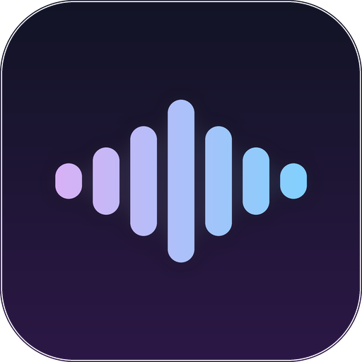
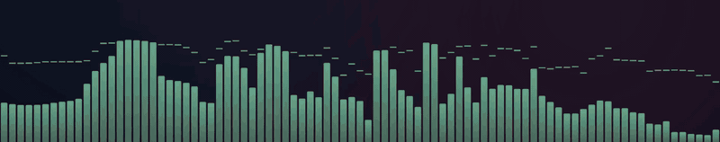
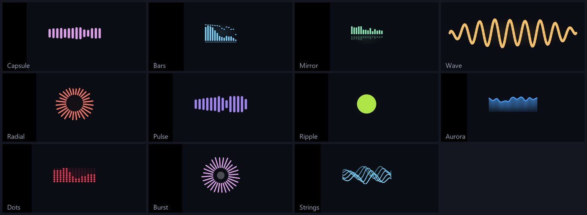
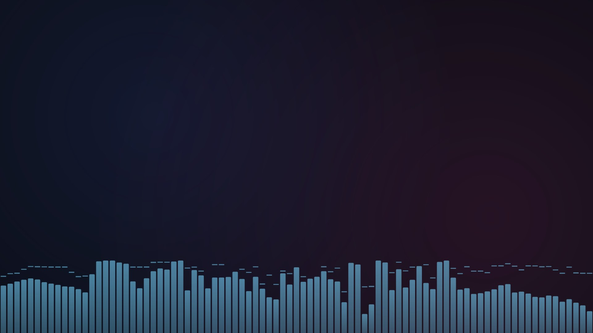
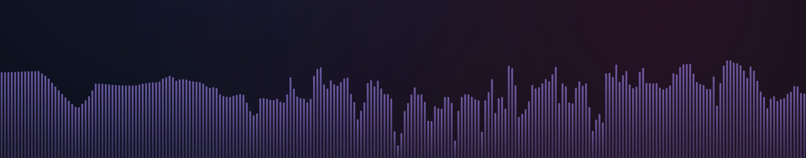
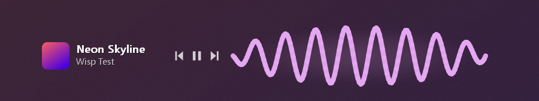

  

<h1 align="center">wispviz</h1>

  A tiny, transparent audio visualiser for Windows. 
  <b>One ~180 KB exe &middot; ~4 MB RAM &middot; no installer, no runtime, no dependencies.</b>

  

## Install

1. Download **`wispviz.exe`** from the [latest release](../../releases/latest).
2. Double-click it and choose **Yes**. That is the whole install: it copies itself to your user folder, **starts with Windows**, and adds a Start Menu entry. No admin rights needed.

Or from a terminal: `wispviz.exe --install` (add `--quiet` for no dialogs). Remove it any time from **Settings > Apps > wispviz** or with `wispviz.exe --uninstall`.

> Windows may show a SmartScreen warning because the exe is not code-signed. Choose *More info > Run anyway*, or [build it yourself](#build).

## What it does

- **Syncs with whatever you hear**: Spotify, YouTube, games, anything. It taps the final audio mix (WASAPI loopback), so there is nothing to configure per app.
- **Fully transparent**: just the bars floating on your desktop. Drag it anywhere, or snap it onto the taskbar strip.
- **11 animations**, **10 colours** (cycling every 2 s by default), and an optional **new animation for every song**.
- **Energetic**: auto-gain follows each song's loudness and a beat detector makes every style jump and glow on drum hits. *Energy*: Calm / Normal / Punchy.
- **Size slider** (6 to 50) scales the whole widget live.

### Screen mode
A full-width visualiser standing on the bottom edge of your screen, like a Linux rice. Faint by default (35 % opacity, 16 % of the screen height, both adjustable), click-through, and behind your windows unless you choose otherwise. Toggle with **Ctrl+Alt+V** or the tray icon.

  
  

### Song panel (optional)
Album art, title, artist and previous / play-pause / next, for any player that appears in the Windows media flyout (Spotify, YouTube in Edge or Chrome, Media Player...).

## Use
**Drag** to move. **Right-click** for the menu (animation, size, energy, colour, cycling, visibility, screen mode, song panel, start with Windows). Settings persist in `wispviz.ini` next to the exe (see [`wispviz.ini.example`](wispviz.ini.example)). Launch with `--snap` to start docked on the taskbar.

Bluetooth headphones play audio ~100-200 ms late, so the bars look early. Set `delay_ms` (0-500) in `wispviz.ini` to match.

## Requirements
Windows 10 (1809) or newer, 64-bit. Built and tested on Windows 11 only.

## Footprint (measured on the author's PC)
| | Private RAM | CPU (of whole machine) |
|---|---|---|
| Widget, song panel on, music playing | 3.7 to 4.3 MB | about 0.1 to 0.6 % |
| Screen mode, default size | about 4.2 MB | about 2 % |
| Screen mode, 60 % height (worst case) | about 7.7 MB | about 2.5 % |

## Build
Needs a MinGW-w64 toolchain (`g++` and `windres`); the portable [w64devkit](https://github.com/skeeto/w64devkit) works with no install. Then `make` or `build.bat`. It only uses DLLs that ship with Windows.

## Honest limits
- Windows 11 removed real taskbar extensions, so "taskbar mode" is a small window placed over the taskbar strip, not an embedded deskband. *Snap to taskbar* (or `--snap`) places it; it does not follow if you move the taskbar later.
- Song info comes from Windows' media session list. Players that do not register there show "Nothing playing"; the bars still work.
- Screen mode covers the main monitor only and uses more CPU than the small widget, because it redraws a full-width window.

## Learn / extend
- [docs/HOW_IT_WORKS.md](docs/HOW_IT_WORKS.md): the pipeline, file by file.
- [docs/ADD_A_STYLE.md](docs/ADD_A_STYLE.md): add your own animation in ~15 lines.

## License
[MIT](LICENSE)
